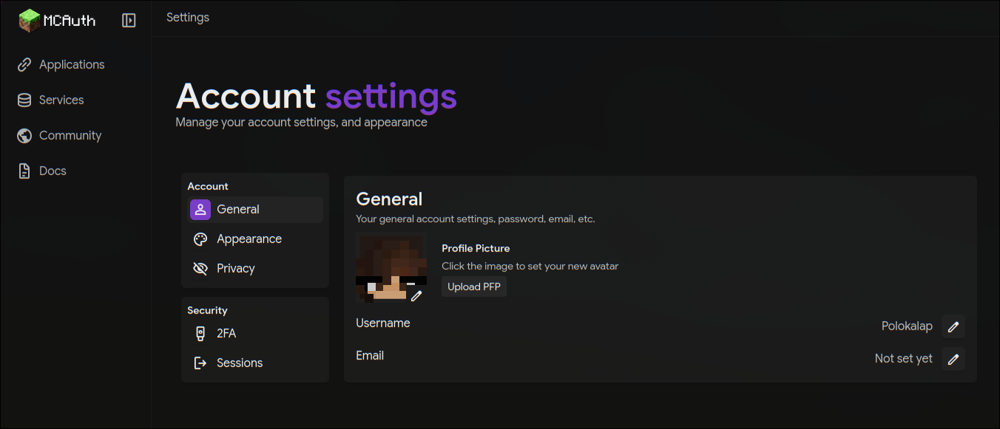
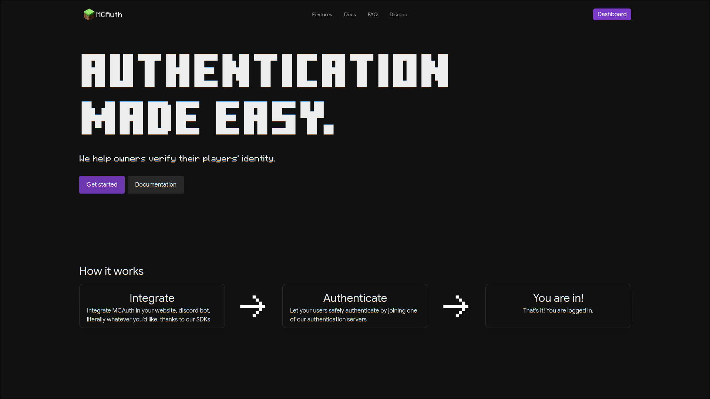
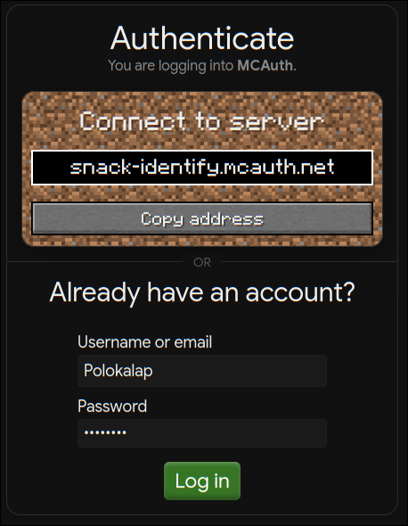

---

## What is MCAuth?
Wow! It's really convenient that you asked that! MCAuth is basically a project that helps developers authenticate their users' minecraft accounts, without hosting their own server for that.

## Does the project work?
Nope! It's still under **heavy** development. As of writing this, only a handful of pages work.

## What works currently then?
Currently, login & registration works, and that's about it! Disappointing, right? The reason for that is that I focus on the UI and UX a lot, both for mobile and desktop. And I do not have a boss, so I get to polish every single little detail. There was also a ton of misunderstanding with our api developer, and basically I wasted like 10 hours on stuff that I ended up deleting, but that's not relevant!! Originally, a settings page would've also been included along with an onboarding, but I ran out of time. I linked photos of the UI bellow, you can see how they look.

## What's planned, in what order?
Wow! Great question! So currently, I plan on finishing the onboarding and the settings first. Then, I think the most important is to make the Services and Applications section (basically OAuth), then the SDKs. The documentation page has the lowest priority.

## License
This project is licensed under the [MIT License](https://mit-license.org).

## Contribution & Self-Hosting
This project is not designed for self-hosting. Yes, decentralization is an AMAZING thing, but for this project, it's not viable **yet**.
To start up the server, you need to clone the project with `git clone https://github.com/MCAuth-net/website.git`, then install all the packages with `npm i` and finally start up the server by running `npm run dev`.
Contributions that are high-quality, and aren't AI slop are welcome.

## Images

(the color scheme system is done, and it'll be released along with the user settings)

